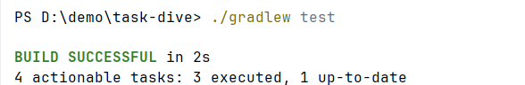

# 跳水成绩查询

### 版本：

Gradle 9.8.1

Kotlin:        2.4.10

Groovy:        4.0.33

Launcher JVM:  25.0.4.1 (Oracle Corporation 25.0.4.1+1-LTS-5)

### 构建:

./gradlew clean build

### 运行: 

IDEA:

./GRADLEW RUN

JAR:

java -jar ./build/libs/DWASearch.jar input.txt(需改为实际路径) output.txt(需改为实际路径)

### 测试: 

./gradlew test

**数据来源**: [World Aquatics Diving World Cup 2026 - Super Final](https://www.worldaquatics.com/competitions/5019/world-aquatics-diving-world-cup-2026-super-final)

抓取时间: 2026-10-21

抓取脚本: 无，参考仓库手动抓取

## JSON 结构

#### 运动员: 
```azure
Full Name: 
Gender: 
Country:
----
```

#### 赛事
```azure
--------DisciplineName:    --------
Phase:
Rank:
// 运动员
DivePoint: 
```

已完成功能

对赛事、运动员数据进行访问输出，对运动员数据、参数传递数量、Json 文件访问(损坏/无法访问)、文件输入输出 进行了自动化测试

### 测试项目
```azure
            "players",
            "Men's 10m Platform",
            "Men's 3m Springboard",
            "Women's 10m Platform",
            "Women's 3m Springboard",
            "Men's 10m Synchronised",
            "Mixed 3m & 10m Team",
            "Men's 3m Synchronised",
            "Women's 10m Synchronised",
            "Women's 3m Synchronised"
```
**空行处理**：将其视为用户输入任务进行处理

**运行限制**：暂未发现

## 具体类

Athlete: 运动员类，包含运动员姓名、性别、所属国家

Country: 国家类，包含国名、运动员列表

Event: 运动会名称

Phase: 阶段类，考虑到一个赛事包含不同阶段，包含排名列表

RankPoint: 排名分数类，包含排名和分数，以及运动员列表

Disciplines: 赛事类，包含阶段列表

## 数据处理类

AthleteSearch: 重定向输出运动员数据到文件

SingleSearch:  将个人赛事数据作为返回值

GroupSearch:   将团队赛事数据作为返回值


OrderClass: 排序类，用于按照国名、运动员姓名进行升序排序

OutputClass: 输出类，包含了 Athlete, Phase, RankPoint, Disciplines 的输出方法

ProjectMatcher: “猜你想搜”功能，提高用户输入的容错，只要用户不乱输，都能输出最符合输入的要求，同时也处理了用户乱输的情况

TaskRunner: 重定向输出数据到文件(三个数据读入类的综合，方便统一测试)

DataUtil: 处理读取数据的方式，由于打包后无法再读取目录，因此文件路径不能写死，因此通过 URI 类重构了读取方法，并将其运用于数据读入类

DWASearch: 主运行类

InvalidInputException: 抛出错误类型自定义，主类和测试类都用到了，所以放到了 main 文件夹底下

## 自动化测试类

AthleteOutputTest: 运动员数据输出测试，测试了数据输出的格式，通过测试

FileNormalTest: 所有数据正常输出测试，测试了用户输错、乱输、正确输入的输出结果

JsonErrorTest: JSON 文件损坏测试

JsonTest: JSON 文件存在、读取测试

MissArgumentTest: 实参个数测试

**所有自动化测试均已通过**




### 注意事项

为了利于分辨，每个运动员成绩后面用#######隔开，而没有按照题目要求的------

运行时，input.txt 文件内容不论大小写，有无空格，或者一些输入小错误都可以正常输出，ProjectMatcher 已经对此进行过处理

如果想要输出各个赛事全部阶段数据，将 OutputClass 类中方法 OutputPhase() 的判断条件去掉即可

如果不想查询赛事数据时每一行都输入 result, 将 ProjectMatcher 中的 similarity 括号里的 "result" 去掉即可

input.txt, output.txt 是测试样例，可以删除